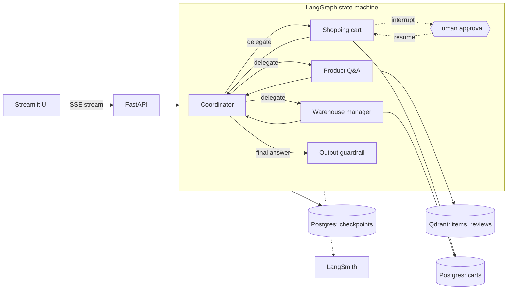

# Multi-Agent Shopping Assistant

A production-style, tool-using multi-agent system for e-commerce. A coordinator agent delegates to specialised workers that answer product questions over hybrid-retrieved catalogue and review data, manage a shopping cart behind a human approval gate, and check and reserve stock in a warehouse database.

The project is built to show how an LLM application is engineered beyond a prototype. It covers retrieval design, bounded agent control flow, durable state, guardrails, evaluation as a CI gate, tracing, protocol interoperability (MCP and A2A) and containerised delivery.

## System design



### Control flow

1. The UI sends the user message to `POST /agent/` and consumes a server-sent event stream. The stream carries progress messages (for example "Looking for items: ...") and structured events such as `hitl_interrupt`.
2. The coordinator is the entry point of the graph. It emits either a delegation (`next_agent`, `next_agent_task`) or a final answer, and receives control back after every worker run.
3. Each worker runs a tool loop with a hard iteration budget (Q&A 5, cart 4, warehouse 4, coordinator 6). When the budget is exhausted the tool set is reduced to the final-response schema only, which forces termination with a best-effort answer instead of looping.
4. Workers are called with `tool_choice="required"`. Every turn ends in a tool call, and the final answer is itself a Pydantic-typed tool, so routing logic reads structured fields and never parses free text.
5. The final answer passes through an output guardrail before it is returned.
6. State is checkpointed in Postgres per thread, which is what makes interrupt and resume possible.

## Design decisions

| Decision | Rationale |
| --- | --- |
| **Coordinator plus specialised workers** instead of one agent with all tools | Smaller tool sets and prompts per agent improve tool selection accuracy, and each agent can be evaluated and iterated on in isolation. Delegation accuracy is directly measurable. |
| **Hybrid retrieval with re-ranking** | Dense and BM25 candidates (20 each) are fused with weighted Reciprocal Rank Fusion (weights 3:1 in favour of dense), then the top candidates are re-ranked with Cohere `rerank-v4.0-pro`. Dense retrieval handles paraphrase and BM25 recovers exact model names and part numbers. |
| **Human approval before cart mutation** | State-changing tools are the highest-risk actions. `add_to_shopping_cart` triggers a LangGraph `interrupt`, and the graph resumes only after an explicit confirm or reject via `POST /send_hitl_response/`. |
| **Reservation gated on cart state** | The coordinator prompt only routes to the warehouse agent after the user has confirmed a reservation and the item is already in the cart. Side effects are ordered and auditable. |
| **Provider fallback through LiteLLM** | Each agent holds an ordered model list (`gpt-5.4-mini`, then `groq/llama-3.3-70b-versatile`) with a prompt variant per model, so a provider outage degrades quality rather than availability. |
| **Prompts as versioned artefacts** | Prompts are Jinja2 templates in YAML with per-model variants and a version field. A loader can also pull them from the LangSmith prompt registry. |
| **Deterministic output guardrail** | Internal product identifiers (ASINs) are redacted with a Guardrails AI validator that uses a regex and an automatic fix. A deterministic check is cheaper and more reliable than an LLM judge for this failure mode. |
| **Evaluation as a release gate** | CI fails a pull request when coordinator delegation accuracy falls below the threshold (0.65). Retrieval is evaluated separately with RAGAS metrics. |
| **MCP and A2A at the edges** | Retrieval is exposed as MCP servers, and the warehouse agent is exposed as an A2A service on Google ADK. Capabilities can be reused by other clients without importing this codebase. |

## Evaluation

| Suite | What it measures | Command |
| --- | --- | --- |
| Retriever | ID-based context precision and recall, plus RAGAS faithfulness and response relevancy | `make run-evals-retriever` |
| Retriever (extended) | The same metrics on a larger dataset | `make run-evals-retriever-extended` |
| Coordinator | Exact match on `next_agent` and `final_answer` for the first delegation step | `make run-evals-coordinator-agent` |

Runs are recorded as LangSmith experiments. The coordinator suite is wired into [.github/workflows/ci.yaml](.github/workflows/ci.yaml), which runs on every pull request to `main`. It fails on any evaluator error or when the mean score is below the threshold.

Every LLM, retrieval and tool call is traced with `@traceable`. Trace IDs are returned to the client so user feedback can be attached to the exact run.

## Repository layout

```
apps/
  api/                          FastAPI service, LangGraph graph, agents, tools, prompts
    src/api/agents/             agents.py, graph.py, tools.py, guardrails.py, prompts/*.yaml
    src/api/api/                HTTP endpoints, request and response models
    evals/                      LangSmith evaluation entry points
  chatbot_ui/                   Streamlit client with suggestions and cart panels
  items_mcp_server/             MCP server: product search
  reviews_mcp_server/           MCP server: review search
  adk_warehouse_manager_agent/  Warehouse agent on Google ADK
  a2a_warehouse_manager_agent/  Same agent served over the A2A protocol
data/processed/                 Sampled Amazon Electronics items and reviews
notebooks/                      Staged development notebooks
scripts/{sql,aws,ci}/           Schemas, IAM policy templates, ECS task-definition builders
.github/workflows/              CI (evals) and CD (image build, push to ECR)
```

The repository is a `uv` workspace. Each service under `apps/` has its own `pyproject.toml` and Dockerfile, and a single lockfile pins the whole tree.

## Tech stack

| Layer | Technology |
| --- | --- |
| Orchestration | LangGraph, LangChain, LiteLLM |
| Models | OpenAI, Groq (fallback), Gemini (ADK agent) |
| Retrieval | Qdrant (dense and sparse vectors), Cohere rerank |
| Contracts | Pydantic, `instructor`, tool-call schemas |
| Services | FastAPI, Streamlit, FastMCP, A2A SDK |
| State | Postgres (checkpoints, cart, warehouse), Supabase |
| Quality | LangSmith, RAGAS, Guardrails AI |
| Delivery | Docker, GitHub Actions, AWS ECR and ECS |

## Running locally

Prerequisites: Python 3.12, [uv](https://github.com/astral-sh/uv), Docker, and API keys for OpenAI, Groq, Cohere and LangSmith.

```bash
cp env.example .env        # set OPENAI_API_KEY, GROQ_API_KEY, CO_API_KEY, LANGSMITH_API_KEY
make run-docker-compose
```

| Service | URL |
| --- | --- |
| Streamlit UI | http://localhost:8501 |
| API docs (OpenAPI) | http://localhost:8000/docs |
| Qdrant dashboard | http://localhost:6333/dashboard |

**Seed the data.** The vector collections and database tables are created by notebooks and SQL scripts, not at container start.

1. Run `notebooks/02_retrieval_and_prompts/03-Hybrid-Search.ipynb` to build `Amazon-items-collection-01-hybrid-search`.
2. Run `notebooks/04_multi_turn_and_mcp/02-Multiple-Tools.ipynb` to build `Amazon-reviews-collection-01`.
3. Apply the schemas in [scripts/sql](scripts/sql) to the cart and warehouse database.

More setup detail is in [documentation/development-environment](documentation/development-environment/README.md).

## Notebooks

The notebooks record how each capability was designed and validated before it was moved into `apps/`.

| Stage | Focus |
| --- | --- |
| `00_llm_api_basics` | Provider APIs |
| `01_rag_foundations` | Dataset analysis, baseline RAG, tracing, first evals |
| `02_retrieval_and_prompts` | Structured outputs, hybrid search, re-ranking, prompt management |
| `03_langgraph_agents` | Graph primitives, query rewriting, routing, single-turn tool agents |
| `04_multi_turn_and_mcp` | Multi-turn state, feedback capture, MCP, streaming |
| `05_multi_agent_system` | Cart, coordinator and warehouse agents |
| `06_evals_and_interoperability` | Failure-mode analysis, evals, LiteLLM, ADK, A2A |
| `07_production_hardening` | Human-in-the-loop, prompt caching, gateway routing, guardrails, managed Qdrant and Supabase |

## Deployment

[.github/workflows/build.yaml](.github/workflows/build.yaml) builds the API and UI images and pushes them to Amazon ECR using GitHub OIDC, then renders ECS task definitions from [scripts/ci](scripts/ci). The IAM documents in [scripts/aws](scripts/aws) are templates. Replace `<AWS_ACCOUNT_ID>`, `<GITHUB_OWNER>` and `<REPOSITORY>`, and keep provider keys in AWS Secrets Manager.

## Known limitations and next steps

- **No authentication.** The thread ID doubles as user and cart identifier, and CORS is open (`*`). Both are acceptable for local use and need replacing with real identity before exposure.
- **Silent fallback.** Model failover logs and moves on. It needs structured error handling, retry with backoff, and an explicit failure when every provider fails.
- **Small corpus.** Retrieval is tuned on a 1,000-item sample. Fusion weights and the re-ranker depth should be re-tuned on a larger catalogue.
- **Narrow coordinator eval.** The current suite covers first-step delegation only. Multi-turn trajectories and end-to-end task success are not yet scored.
- **Hard-coded service addresses.** The A2A agent binds to `localhost:10001`, and the MCP servers assume the `qdrant` service hostname. Both should move to configuration.

## Acknowledgements

This project was developed as part of an AI engineering bootcamp. The curriculum and the initial structure of the codebase come from that programme, and the Apache 2.0 license of the original material is retained in [LICENSE](LICENSE).

Product and review data come from the Amazon Reviews 2023 dataset. If you use it, please cite:

```bibtex
@article{hou2024bridging,
  title={Bridging Language and Items for Retrieval and Recommendation},
  author={Hou, Yupeng and Li, Jiacheng and He, Zhankui and Yan, An and Chen, Xiusi and McAuley, Julian},
  journal={arXiv preprint arXiv:2403.03952},
  year={2024}
}
```

## License

Apache License 2.0. See [LICENSE](LICENSE).
